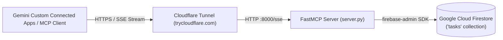

# GeminiTaskMCP - Remote Firestore Model Context Protocol (MCP) Server

A production-ready remote **Model Context Protocol (MCP)** server built with **FastMCP** (Python SDK) and **firebase-admin** that connects directly to **Google Cloud Firestore**.

It enables **Gemini Custom Connected Apps**, **Claude**, or any MCP-compliant client to manage tasks in Firestore in real time over **Server-Sent Events (SSE)** and **HTTP**, securely exposed via **Cloudflare Tunnel**.

---

## 🏗️ System Architecture



---

## 📁 Project Structure

```text
.
├── server.py                     # FastMCP server with 4 Firestore task management tools
├── requirements.txt              # Production Python dependencies (mcp, firebase-admin, uvicorn)
├── serviceAccountKey.json.example# Template for the Firebase service account credential
├── test_tools.py                 # Automated unit test suite verifying tool logic and validations
├── .gitignore                    # Prevents leaking service account keys and virtualenv files
└── README.md                     # Step-by-step setup and connection instructions
```

---

## 🗄️ Firestore Database Schema

The server manages documents inside the top-level **`tasks`** collection:

| Field Name | Type | Description |
| :--- | :--- | :--- |
| `title` | `string` | The task description or summary. |
| `priority` | `string` | Task priority (`"High"`, `"Medium"`, or `"Normal"`). |
| `completed` | `boolean` | Completion flag (`False` for pending, `True` for completed). |
| `created_at` | `timestamp` | Server timestamp set by `firestore.SERVER_TIMESTAMP`. |

---

## 🛠️ MCP Tools Reference

The server exposes 4 well-documented tools with full type hints:

### 1. `add_task(title: str, priority: str = "Normal") -> str`
- **Description:** Adds a new document to the `"tasks"` collection.
- **Parameters:**
  - `title` (*required*): Non-empty task description.
  - `priority` (*optional*): Must be `"High"`, `"Medium"`, or `"Normal"` (case-insensitive, defaults to `"Normal"`).
- **Returns:** Confirmation message with the newly generated Firestore Document ID.

### 2. `get_tasks(status: str = "all") -> str`
- **Description:** Retrieves tasks ordered by `created_at` descending (newest first).
- **Parameters:**
  - `status` (*optional*): Filter tasks. Options:
    - `"all"` (default): Returns all tasks.
    - `"pending"`: Returns only uncompleted tasks (`completed: false`).
    - `"completed"`: Returns only completed tasks (`completed: true`).
- **Returns:** Clean, formatted task list showing Document ID, Title, Priority, Status, and Creation Date.

### 3. `complete_task(task_id: str) -> str`
- **Description:** Finds the task document by ID in `"tasks"` and updates `completed` to `True`.
- **Parameters:**
  - `task_id` (*required*): Firestore Document ID.
- **Returns:** Success confirmation or a clear `"Task ID not found"` error message.

### 4. `delete_task(task_id: str) -> str`
- **Description:** Deletes the document with `task_id` from the `"tasks"` collection.
- **Parameters:**
  - `task_id` (*required*): Firestore Document ID.
- **Returns:** Deletion confirmation or `"Task ID not found"` error message.

---

## 🚀 Step-by-Step Setup Guide

### Step 1: Prerequisites
- **Python 3.10+** installed
- **Node.js & npx** installed (for Cloudflare Tunnel)
- A **Google Firebase / Google Cloud Project** with **Firestore Database** enabled (Native mode)

---

### Step 2: Create and Activate a Virtual Environment

Open your terminal in the project directory:

```bash
# Create a virtual environment
python3 -m venv .venv

# Activate the virtual environment
# On Linux/macOS:
source .venv/bin/activate

# On Windows (cmd):
# .venv\Scripts\activate.bat

# On Windows (PowerShell):
# .venv\Scripts\Activate.ps1
```

---

### Step 3: Install Dependencies

```bash
pip install -r requirements.txt
```

---

### Step 4: Obtain & Place `serviceAccountKey.json`

1. Navigate to the [Firebase Console](https://console.firebase.google.com/).
2. Select your Firebase project.
3. Click the gear icon ⚙️ (next to Project Overview) and select **Project settings**.
4. Go to the **Service accounts** tab.
5. Ensure **Firebase Admin SDK** is selected, and click **Generate new private key**.
6. Confirm by clicking **Generate key**. A `.json` file will download to your computer.
7. Rename the downloaded file to **`serviceAccountKey.json`** and place it directly in the root of this project folder:
   ```text
   /path/to/project/serviceAccountKey.json
   ```

> [!IMPORTANT]
> Never commit `serviceAccountKey.json` to version control. The included `.gitignore` already ignores it.

*(Optional)* You can also specify a custom path using an environment variable:
```bash
export FIREBASE_SERVICE_ACCOUNT_KEY="/path/to/your/custom-key.json"
```

---

### Step 5: Start the FastMCP Server

Run the server script:

```bash
python server.py
```

You will see output similar to:
```text
======================================================================
  🚀 GeminiTaskMCP: Remote Firestore MCP Server Starting
======================================================================
  • Transport:   SSE (Server-Sent Events) / HTTP
  • Host/Port:   http://0.0.0.0:8000
  • SSE Stream:  http://0.0.0.0:8000/sse
  • Messages:    http://0.0.0.0:8000/messages/
  • Collection:  'tasks'
----------------------------------------------------------------------
  Public Tunnel Command (Cloudflare):
    npx cloudflared tunnel --url http://localhost:8000
======================================================================
```

The server is now running locally on port `8000` listening for SSE connections.

---

### Step 6: Expose Port 8000 via Cloudflare Tunnel

In a **separate terminal window**, expose the local server using `npx cloudflared`:

```bash
npx cloudflared tunnel --url http://localhost:8000
```

Cloudflare will generate a public URL. Look for the line in the terminal output:

```text
+--------------------------------------------------------------------------------------------+
|  Your quick Tunnel has been created! Visit it at (it may take some time to be reachable):  |
|  https://random-words-1234.trycloudflare.com                                               |
+--------------------------------------------------------------------------------------------+
```

Copy your public HTTPS URL (e.g. `https://random-words-1234.trycloudflare.com`).

Your remote MCP SSE endpoint is:
```text
https://random-words-1234.trycloudflare.com/sse
```

---

## 🔗 Connecting to Gemini Custom Connected Apps

1. Open **Gemini** (or your Gemini Advanced workspace).
2. Go to **Settings** > **Connected Apps / Extensions** (or **Custom MCP Server** configuration).
3. Select **Add Custom MCP Server**.
4. Configure the server:
   - **Server Name:** `GeminiTaskMCP`
   - **Transport Type:** `SSE` (Server-Sent Events)
   - **Server URL:** `https://your-tunnel-url.trycloudflare.com/sse`
5. Click **Connect** / **Save**.
6. Gemini will query the server capabilities and discover the 4 tools (`add_task`, `get_tasks`, `complete_task`, `delete_task`).

### Example Prompts for Gemini:
- *"Add a High priority task titled 'Prepare Q4 Product Review' to my tasks."*
- *"Show all my pending tasks."*
- *"Mark the task with ID `<document_id>` as complete."*
- *"Delete the task with ID `<document_id>`."*

---

## 🧪 Running the Unit Tests

The project includes unit tests with mocked Firestore calls so you can verify all tool behaviors, priority validations, and filter logic without needing live Firebase credentials:

```bash
python test_tools.py
```

Expected output:
```text
Ran 13 tests in 0.013s

OK
```

---

## 🔒 Security & Production Best Practices

1. **Firewall / Tunnel Security:**
   - For temporary testing, `npx cloudflared` creates an ephemeral quick tunnel.
   - For production environments, configure a **Cloudflare Named Tunnel** with Cloudflare Access (Zero Trust) to restrict access using authentication tokens or service tokens.
2. **Firestore Security Rules:**
   - The `firebase-admin` SDK runs with service account privileges and bypasses client-side Firestore Security Rules. Ensure your service account has minimum required IAM roles (e.g., `Cloud Datastore User` or `Firebase Admin SDK Administrator Service Agent`).
3. **Persistent Hosting:**
   - You can containerize this server using Docker or deploy it to Google Cloud Run, Cloud VM, or any container host with port `8000` exposed.
